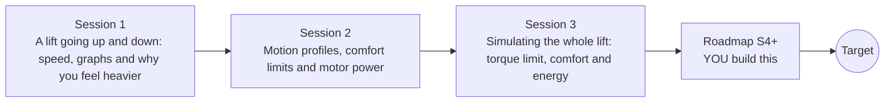

# openelevator

[](https://github.com/KrunalPanchal1995/openelevator/actions/workflows/ci.yml)   [](https://colab.research.google.com/github/KrunalPanchal1995/openelevator/blob/main/sessions/session-01/lesson.ipynb) [](https://krunalpanchal1995.github.io/openelevator/)

**Design a lift ride that is quick and comfortable, in three sessions.**

openelevator teaches how a lift moves, from a speed-time graph to a time-stepping simulation with a counterweight, a motor limit and jerk, using only Python and a browser.

- **Start from a graph.** Session 1 needs only a speed-time graph and Newton's second law, with no calculus.
- **See it move.** Every session ships a slider app that runs in the browser, with labelled graphs.
- **Know you got it right.** Each session ends with a checkpoint that prints PASS or FAIL against hand calculations and an energy balance.
- **Build the missing half.** The repo stops at Session 3 on purpose; the roadmap shows the path to the Target.

[Target](#the-target) · [Who is this for](#who-is-this-for) · [Quick start](#quick-start) · [Sessions](#sessions) · [Roadmap](#roadmap) · [Contribute](#contribute) · [Explainer PDF](docs/explainer.pdf)

> **This repo is incomplete on purpose.** Sessions 1 to 3 are here and fully working. The finished Target below is a preview of what the community can build next. We show you the path, not the code. Sessions 4 and up are yours.

## The Target

A lift shaft is animated with a car and its counterweight moving in opposite directions. Beside it, live graphs of speed, acceleration and jerk are drawn as the ride happens, for two motion profiles at once: a trapezoid profile (red) and a jerk-limited S-curve profile (blue). A comfort meter shows the peak acceleration and peak jerk of each against a comfort limit: the trapezoid arrives sooner but its jerk is many times the limit, while the S-curve stays inside it. Your goal over the coming sessions: build that comparison yourself and then tune the profile so the ride is as fast as the comfort limits allow.


*Target: an animated shaft with car and counterweight, live speed, acceleration and jerk, and a comfort meter for two profiles*


*Target, final frame: the S-curve stays inside the comfort limits, the trapezoid does not*


*How much time does comfort cost? Travel time against distance for both profiles*

Try it live:

- [Math Visual Studio: kinematics (Atlas S35)](https://krunalpanchal1995.github.io/studio/#atlas?ch=S35&ex=1)
- [Math Visual Studio: free-body diagrams (Atlas S37)](https://krunalpanchal1995.github.io/studio/#atlas?ch=S37&ex=1)

How the Target was made is shown only as a path in [promo/roadmap.md](promo/roadmap.md).

## Who is this for
**middle school to higher secondary (levels 2-4).** Topic area: Everyday Life and Practical Knowledge.

Prerequisites:

- Speed, acceleration and the idea of a speed-time graph (school physics).
- Python 3.10 or newer; if `python --version` works, you are ready. PRIMER.md explains the rest.
- No prior GitHub, calculus or engineering experience is needed.

New to Python? Read [PRIMER.md](PRIMER.md) first (10 minutes).

## Quick start

No installation knowledge needed. You need [Git](https://git-scm.com/downloads) and [Python 3.10+](https://www.python.org/downloads/) (Windows: tick "Add Python to PATH"). On Mac and Linux type `python3` wherever this page says `python`.

```bash
git clone https://github.com/KrunalPanchal1995/openelevator.git
cd openelevator
python start.py 1
```

`start.py` creates a private environment, installs what is needed and runs Session 1 with its checkpoint. Next: `python start.py 2`, `python start.py 3`, or `python start.py test` to check everything. Only a checkpoint: `python start.py check 1`.

Four lines turn the idea of Session 1 into a result (they work as they are): Save it as `try.py` and run it with `python start.py run try.py` (this uses the private environment, where NumPy is installed):

```python
import numpy as np
m, g, a = 60.0, 9.81, 1.0                      # person (kg), gravity, lift speeding up (m/s^2)
N = m * (g + a)                                 # force of the floor on the person (newtons)
print(round(N, 1), 'N instead of', round(m * g, 1), 'N at rest')   # -> 648.6 N instead of 588.6 N
```

Every session also opens in your browser with sliders (no install): [live apps](https://krunalpanchal1995.github.io/openelevator/). Or use the Colab badge above for the notebook.

## Sessions

| # | Session | Model level | Time | Live app |
|---|---|---|---|---|
| 1 | [A lift going up and down: speed, graphs and why you feel heavier](sessions/session-01/README.md) | Level 1: conceptual interactive model | 60 min | [open](https://krunalpanchal1995.github.io/openelevator/session-01/) |
| 2 | [Motion profiles, comfort limits and motor power](sessions/session-02/README.md) | Level 2: mathematical engineering model | 75 min | [open](https://krunalpanchal1995.github.io/openelevator/session-02/) |
| 3 | [Simulating the whole lift: torque limit, comfort and energy](sessions/session-03/README.md) | Level 3: simulation and validation | 90 min | [open](https://krunalpanchal1995.github.io/openelevator/session-03/) |

Each session follows the same six steps: A real-world problem, B concept and theory, C visual explanation, D interactive simulation, E worked example and experiment, F assessment and design challenge. Each ends with `checkpoint.py`, which prints `PASS` or `FAIL` against reference numbers. Session 3 also contains the real-world mini-project: **Choose the motor and the profile for a 10-storey building**.

## Architecture



| Folder or file | What is inside |
|---|---|
| `sessions/` | three sessions: README (A-F), `lesson.py`, notebook, live app, exercises, activity sheet, checkpoint |
| `promo/` | the Target: media, live links, and the roadmap (path only) |
| `docs/` | `explainer.tex` and the built `explainer.pdf` |
| `tests/` | runs every lesson and checkpoint headless |
| `start.py` | one command to set up and run anything |
| `QUALITY.md`, `RUBRIC.md` | the quality checklist and the scoring rubric |
| `.github/` | CI, PDF build, Pages deploy, issue and PR templates |

## Roadmap

| Milestone | What you will build | Difficulty |
|---|---|---|
| Session 4: Cleaner jerk: feed-forward the force lag | A controller that anticipates the motor lag, so that the jerk the passengers feel stays close to the jerk of the plan. | intermediate |
| Session 5: Fastest ride inside the comfort box | A search that picks the plan with the shortest travel time whose simulated ride stays inside a peak acceleration of 1.2 m/s^2 and a peak jerk of 2.5 m/s^3. | intermediate |
| Session 6: A day of traffic: energy over many trips | An estimator of the energy used in a day of 200 trips with random loads and directions, compared with the counterweight mass. | intermediate |
| Session 7: A stretchy rope: car vibration | A two-mass model (car and sheave) joined by a spring that represents the rope stretch. | advanced |
| Session 8: Two lifts, one lobby: group control | A simulation of two lifts serving a 10-floor building with random calls. | advanced |

Full detail with a checkpoint per milestone: [promo/roadmap.md](promo/roadmap.md).

## Contribute
New to GitHub? Read [CONTRIBUTING.md](CONTRIBUTING.md); it starts from zero. Pick an issue labelled `good first issue`. Translations into Hindi, Telugu, Tamil and Malayalam are welcome.

<details>
<summary>Development</summary>

```bash
python start.py test        # runs every lesson and checkpoint
```
Lessons use `# %%` cell markers so they open as notebooks in VS Code. See [QUALITY.md](QUALITY.md) for the standard every session meets.
</details>

## License
MIT. See [LICENSE](LICENSE). Media in `promo/media` is (c) Krunal Panchal, CC BY 4.0.

## Acknowledgments
Part of the [PAN IIT OSS](https://hellofoss.tech-iitb.org/projects) open-source teaching collection, modelled on the structure of [openspline](https://github.com/openspline/openspline). Built on ideas from the Math Visual Studio at https://krunalpanchal1995.github.io/studio/.
