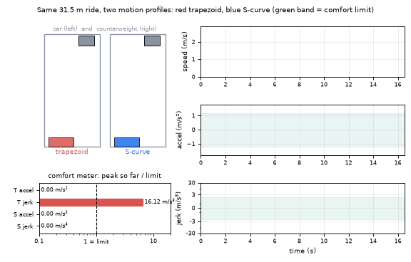
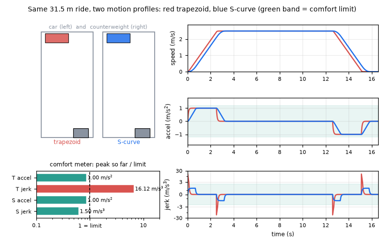
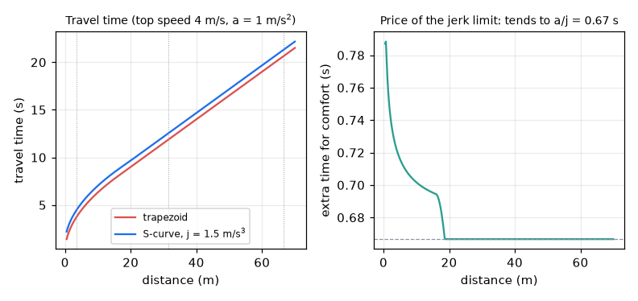

# What you are building toward

A lift shaft is animated with a car and its counterweight moving in opposite directions. Beside it, live graphs of speed, acceleration and jerk are drawn as the ride happens, for two motion profiles at once: a trapezoid profile (red) and a jerk-limited S-curve profile (blue). A comfort meter shows the peak acceleration and peak jerk of each against a comfort limit: the trapezoid arrives sooner but its jerk is many times the limit, while the S-curve stays inside it. Your goal over the coming sessions: build that comparison yourself and then tune the profile so the ride is as fast as the comfort limits allow.

*Target: an animated shaft with car and counterweight, live speed, acceleration and jerk, and a comfort meter for two profiles*

*Target, final frame: the S-curve stays inside the comfort limits, the trapezoid does not*

*How much time does comfort cost? Travel time against distance for both profiles*

These results come from a private reference build. The code is not published; the roadmap shows the path so you can build your own.

Live links:

- [Math Visual Studio: kinematics (Atlas S35)](https://krunalpanchal1995.github.io/studio/#atlas?ch=S35&ex=1)
- [Math Visual Studio: free-body diagrams (Atlas S37)](https://krunalpanchal1995.github.io/studio/#atlas?ch=S37&ex=1)
