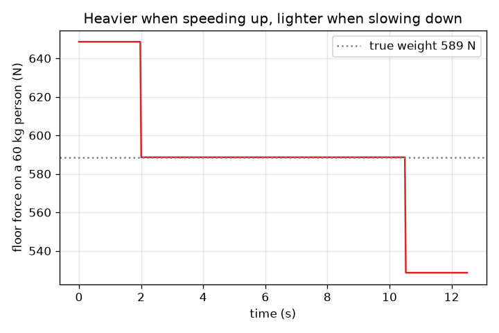
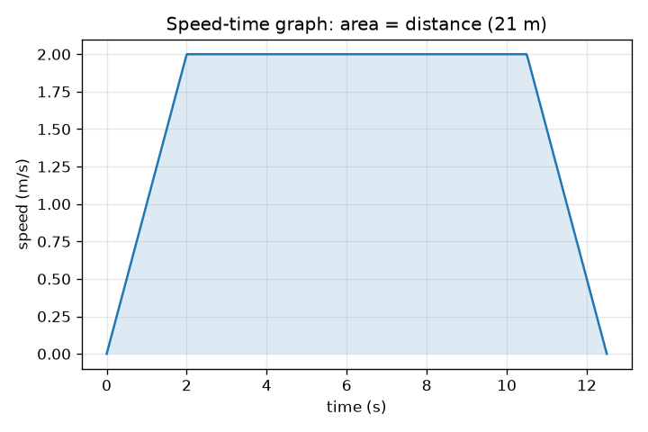

# Session 1: A lift going up and down: speed, graphs and why you feel heavier

*Level 1 (conceptual interactive model) · about 60 minutes · openelevator*

> This is a simplified educational model. It is not a validated design tool and must not be used for real structures, electrical installations, vehicles, industrial processes or medical decisions.

**Prerequisites**

- Speed and acceleration, and reading a speed-time graph.
- You have read PRIMER.md and run `python start.py 1` once.

**Learning objectives.** After this session you can:

- Describe a lift ride as accelerate, cruise, decelerate on a speed-time graph.
- Read the acceleration from the slope and the distance from the area of the graph.
- Use apparent weight N = m (g + a) to say when you feel heavier or lighter.
- Find the time of a ride from distance, top speed and acceleration.

## A. Real-world problem
You step into a lift and, as it starts to rise, the floor seems to push harder on your feet. When it slows near the top you feel a little lighter. Nothing about you has changed, and gravity has not changed either. What has? And how can a designer make a ride quick without making the push on your feet unpleasant?

## B. Concept and theory
A lift ride is simplest to describe with a speed-time graph. The lift speeds up at a constant acceleration a until it reaches the top speed v, travels at v, then slows down at the same rate. The graph is a trapezoid. The slope of the graph is the acceleration and the area under it is the distance. Speeding up to v takes v / a seconds and covers v^2 / (2 a) metres, slowing down is the same, so a ride of distance d takes d / v + v / a seconds as long as d is at least v^2 / a. If the distance is shorter, the lift never reaches v. You feel the force of the floor on your feet, the apparent weight N. Newton's second law for you says net force = mass x acceleration, and the net force is N upward minus your weight m g downward, so N = m (g + a). When the lift accelerates upward (speeding up while going up, or slowing down while going down) a is positive and you feel heavier. When the acceleration points down you feel lighter. At constant speed a = 0 and N = m g. Only the acceleration matters, never the speed.

| Symbol | Meaning | Unit |
|---|---|---|
| d | distance travelled | m |
| v | top (cruise) speed | m/s |
| a | acceleration of the lift, upward positive | m/s^2 |
| m | mass of the person | kg |
| g | gravitational acceleration, 9.81 | m/s^2 |
| N | force of the floor on the person (apparent weight) | N |
| T | total ride time | s |

**Assumptions**

- The lift moves in a straight vertical line with straight-line speed changes (the acceleration jumps instantly).
- The person stands still on the floor.
- Air resistance and friction are ignored.
- Comfort is judged only by the size of the acceleration in this session.

$$ T=\frac{d}{v}+\frac{v}{a}\qquad (d\ge v^2/a) $$

$$ d_{\text{accelerate}}=\frac{v^2}{2a},\qquad t_{\text{accelerate}}=\frac{v}{a} $$

$$ N-mg=ma\;\Rightarrow\;N=m\,(g+a) $$

## C. Visual explanation
The first figure is a speed-time graph of a 21 m ride with a top speed of 2 m/s and an acceleration of 1 m/s^2: a trapezoid with a 2 s rise, an 8.5 s flat top and a 2 s fall, 12.5 s in total, whose shaded area is 21 m. The second figure shows the floor force on a 60 kg person during the same ride: 649 N while speeding up (above the 589 N true weight), 589 N while cruising and 529 N while slowing down.

*Floor force on a 60 kg person: heavier while speeding up, lighter while slowing down.*

*Speed-time graph of a 21 m ride: slope is acceleration, shaded area is distance.*

## D. Interactive simulation
Run the lesson (`python start.py 1`), then open the live app: [Session 1: a lift ride and the force on your feet](https://krunalpanchal1995.github.io/openelevator/session-01/) (or `app.html` in this folder). Move the ride-progress slider and watch the car rise in the shaft and the force bar grow and shrink. Then open the speed graph and the force graph and change the acceleration.

**Challenge.** Make the 21 m ride take less than 12 s while the floor force never exceeds 15 percent above your weight.

## E. Worked example and experiment
**Problem.** A 60 kg person is in a lift that speeds up upward at 1.0 m/s^2. What force does the floor exert, and how does it compare with the person's weight at rest?

1. Weight at rest: m g = 60 * 9.81 = 588.6 N.
2. While speeding up: N = m (g + a) = 60 * (9.81 + 1.0) = 60 * 10.81 = 648.6 N.
3. Ratio: 648.6 / 588.6 = 1.10, so the person feels 10 percent heavier.
4. Slowing down at the same rate (a = -1.0): N = 60 * 8.81 = 528.6 N, about 10 percent lighter.

**Answer.** N = 648.6 N while speeding up (588.6 N at rest, 528.6 N while slowing down).

**Experiment.** Stand on a bathroom scale in a lift (or use a phone app that shows acceleration) and watch the reading as the lift starts and stops. The reading should rise by about 10 percent for a = 1 m/s^2 and fall by the same amount at the end, and return to your normal weight at steady speed. Typical lifts accelerate less than 1 m/s^2, so the changes you see will be smaller. Differences between model and reality: a real scale reacts slowly, the real acceleration is not a perfect step, and the lift may swing a little.

## F. Assessment and design challenge
**Question type A: Conceptual.** A lift is moving downward at a steady speed and then begins to slow down to stop at the ground floor. Do you feel heavier, lighter or the same? Explain without using the word speed.

Hint

Slowing down while moving down means the velocity changes toward up. Which way does the acceleration point?

Step-by-step solution

You feel heavier. The velocity is downward and shrinking, so the change of velocity (the acceleration) points upward. With a upward and positive, N = m (g + a) is larger than m g. What matters is the direction of the acceleration, not the direction of the motion.

**Question type B: Numerical.** A 75 kg person stands in a lift that speeds up upward at 1.5 m/s^2. Find the floor force and the percentage change from the person's weight at rest.

Hint

N = m (g + a) with g = 9.81 m/s^2.

Step-by-step solution

N = 75 * (9.81 + 1.5) = 75 * 11.31 = 848.25 N, about 848 N. Weight at rest = 75 * 9.81 = 735.75 N. Change = 848.25 / 735.75 = 1.153, so 15.3 percent heavier. Unit check: kg * m/s^2 = N.

**Question type C: Graph and simulation interpretation.** On the speed-time graph of the 21 m ride (top speed 2 m/s, rise over 2 s, flat for 8.5 s), what is the acceleration and how can you check that the distance is 21 m?

Hint

Slope = rise over run. Area = two triangles and a rectangle.

Step-by-step solution

Slope of the rising part = (2 - 0) / 2 = 1.0 m/s^2. Area: two triangles of 0.5 * 2 * 2 = 2 m each (4 m) plus a rectangle 2 m/s * 8.5 s = 17 m, total 21 m, which matches the distance.

**Question type D: Design and optimisation challenge.** Design: the 21 m ride must take less than 11 s and the floor force must stay within 15 percent of the person's weight (a <= 1.47 m/s^2). Choose a and v, check d >= v^2 / a, and give the ride time. Why not simply choose a very large v?

Hint

Try a = 1.4 m/s^2 and a few values of v in T = d / v + v / a.

Step-by-step solution

Take a = 1.4 m/s^2 (a/g = 0.143, so 14.3 percent). With v = 3 m/s: v^2 / a = 6.4 m, which is less than 21 m, so the lift reaches full speed. T = 21 / 3 + 3 / 1.4 = 7.0 + 2.14 = 9.14 s, below 11 s. A very large v is not free: the lift needs a stronger motor, more shaft height to slow down safely, and passengers dislike very high speed. With a = 1.4 the time stays under 11 s only for v above about 2.2 m/s, so a v of 2.5 to 4 m/s is a sensible range. Assumptions: constant acceleration, no jerk limit (Session 2 adds it).

Score yourself with [RUBRIC.md](../../RUBRIC.md). Print the [activity sheet](activity_sheet.md) to work on paper.

## Common misconceptions
| Common misconception | What is actually true |
|---|---|
| I feel heavier whenever the lift is moving fast. | Only acceleration changes the floor force. At any steady speed, fast or slow, you feel your normal weight. |
| My weight really changes in a lift. | Gravity pulls on you with the same force. What changes is the force of the floor on you, the apparent weight. |
| Going up always feels heavier and going down always feels lighter. | It depends on the direction of the acceleration: speeding up while going up and slowing down while going down both feel heavier. |
| A bigger top speed always saves time in proportion. | The time is d / v + v / a: part of it is spent speeding up, so doubling v does not halve the time, especially for short rides. |

## Glossary
- **acceleration**: how fast the speed changes, in m/s^2; the slope of a speed-time graph
- **apparent weight**: the force the floor exerts on you; what a scale reads
- **speed-time graph**: a graph of speed against time; slope is acceleration, area is distance
- **cruise**: the part of a ride at constant speed

## Finish
1. Do the three coding tasks in [exercises.md](exercises.md).
2. Run `python start.py 1` again after your changes. It ends with the checkpoint; when it prints `PASS`, you are done. (Checkpoint only: `python start.py check 1`.)

Next: [Session 2](../session-02/README.md)
