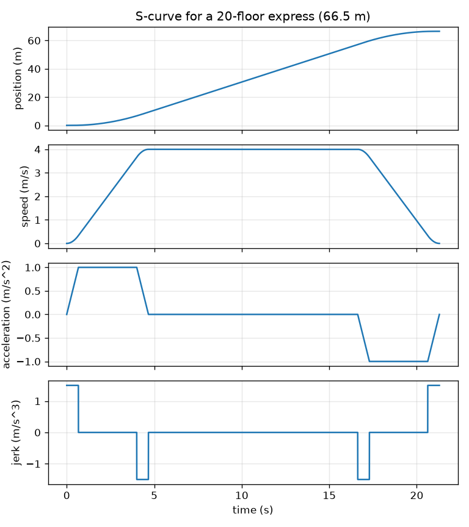
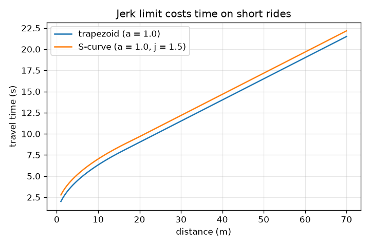

# Session 2: Motion profiles, comfort limits and motor power

*Level 2 (mathematical engineering model) · about 75 minutes · openelevator*

> This is a simplified educational model. It is not a validated design tool and must not be used for real structures, electrical installations, vehicles, industrial processes or medical decisions.

**Prerequisites**

- Session 1: speed-time graphs and apparent weight.
- Solving a quadratic equation (explained in Section B where needed).

**Learning objectives.** After this session you can:

- Compute the travel time of a trapezoid profile and of a jerk-limited S-curve profile.
- Explain jerk and why limiting it makes a ride feel smoother but a little slower.
- Compute the motor power with a counterweight, P = (m_car + m_load - m_cw) g v / efficiency.
- Design the fastest comfortable ride between two floors, then for a 20-floor express.

## A. Real-world problem
Two floors are 3.5 m apart. Session 1 said the ride is quick if the acceleration is large, but a lift that jumps from rest to 1 m/s^2 in an instant feels like a jolt even if the acceleration is small. What really makes a ride comfortable? And how big must the motor be, given that a counterweight balances most of the car? Finally, can the same recipe run a 20-floor express?

## B. Concept and theory
Jerk is the rate of change of acceleration, j = da/dt, measured in m/s^3. A trapezoid profile changes acceleration instantly (infinite jerk on paper), which passengers feel as a jolt at the start and the end of each speed change. An S-curve profile ramps the acceleration up and down at a limited jerk j. It has up to seven phases: jerk +j, constant acceleration, jerk -j, cruise, jerk -j, constant braking, jerk +j. Typical design values for passenger comfort are an acceleration of about 1 to 1.5 m/s^2 and a jerk of about 1 to 2 m/s^3; we use 1.0 m/s^2 and 1.5 m/s^3 as assumed values, not as a standard. To reach speed v the acceleration phase lasts Ta = v / a + a / j if v >= a^2 / j (the acceleration reaches its limit), and Ta = 2 sqrt(v / j) otherwise. Speeding up and slowing down together cover v Ta, so if d >= v Ta the ride takes T = d / v + Ta. For a short ride the cruise speed is lowered until v Ta = d; when the acceleration reaches its limit this gives v^2 + (a^2 / j) v - a d = 0. The car, passengers and a counterweight hang on one rope over the motor sheave, so the motor only has to carry the unbalanced weight (m_car + m_load - m_cw) g, plus a force M a to accelerate the total moving mass M = m_car + m_load + m_cw. At constant speed the motor input power is P = (m_car + m_load - m_cw) g v / eta. A negative value means the load drives the motor.

| Symbol | Meaning | Unit |
|---|---|---|
| j | jerk, rate of change of acceleration | m/s^3 |
| a | acceleration limit | m/s^2 |
| v | cruise speed (maximum speed) | m/s |
| Ta | time to speed up from rest to v | s |
| d | distance of the ride | m |
| T | travel time | s |
| m_car, m_load, m_cw | car, passenger and counterweight masses | kg |
| eta | motor and gear efficiency (0 to 1) | no unit |
| P | motor input power | W |

**Assumptions**

- Rope mass, rotor inertia and friction are ignored.
- The acceleration and jerk limits are assumed comfort figures, not a standard.
- Efficiency eta = 0.85 is a single assumed number.
- The profile is symmetric: speeding up and slowing down use the same limits.
- The counterweight is the car mass plus 45 percent of the rated load (a common rule of thumb).

$$ T_{\text{trap}}=\frac{d}{v}+\frac{v}{a}\quad(d\ge v^2/a),\qquad T_{\text{trap}}=2\sqrt{d/a}\quad(d<v^2/a) $$

$$ T_a=\frac{v}{a}+\frac{a}{j}\quad(v\ge a^2/j),\qquad T=\frac{d}{v}+T_a\quad(d\ge vT_a) $$

$$ v^2+\frac{a^2}{j}v-ad=0\quad\text{(short ride, cruise speed set by the distance)} $$

$$ P=\frac{(m_{\text{car}}+m_{\text{load}}-m_{\text{cw}})\,g\,v}{\eta} $$

$$ F=(m_{\text{car}}+m_{\text{load}}-m_{\text{cw}})\,g+(m_{\text{car}}+m_{\text{load}}+m_{\text{cw}})\,a $$

## C. Visual explanation
The first figure shows a complete S-curve for a 66.5 m express ride, as four stacked graphs against the same time axis: position, speed, acceleration and jerk. Jerk takes only the values +1.5, 0 and -1.5 m/s^3; acceleration is a trapezoid, speed an S-shaped ramp. The second figure plots travel time against distance for both profiles at a top speed of 4 m/s: for long rides the S-curve is a constant a / j = 0.67 s slower, and for short rides the gap is larger because the lift never reaches its full speed.

*An S-curve ride for 66.5 m: position, speed, acceleration and jerk against time.*

*Travel time against distance: the jerk limit costs 0.67 s on long rides.*

## D. Interactive simulation
Run the lesson (`python start.py 2`), then open the live app: [Session 2: profiles, comfort limits and motor power](https://krunalpanchal1995.github.io/openelevator/session-02/) (or `app.html` in this folder). Change the distance and the three limits and watch the speed, acceleration and jerk graphs. Open the power view and change the passenger load. Read the cruise power in the readout.

**Challenge.** Ride 3.5 m in less than 4.2 s with the S-curve, with acceleration at most 1.5 m/s^2 and jerk at most 2 m/s^3.

## E. Worked example and experiment
**Problem.** Two floors are 3.5 m apart. With a maximum speed of 2.5 m/s, acceleration limit 1.0 m/s^2 and jerk limit 1.5 m/s^3, find the S-curve travel time and the cruise speed reached. Then find the motor power at that speed for a full car (1000 kg car, 800 kg load, 1360 kg counterweight, eta = 0.85).

1. Check the full speed first: reaching 2.5 m/s needs Ta = 2.5 / 1.0 + 1.0 / 1.5 = 3.167 s, and v Ta = 7.9 m, much more than 3.5 m. The lift cannot reach 2.5 m/s.
2. Assume the acceleration reaches 1.0 m/s^2. Then v^2 + (a^2 / j) v - a d = 0 becomes v^2 + 0.6667 v - 3.5 = 0.
3. v = (-0.6667 + sqrt(0.4444 + 14)) / 2 = (-0.6667 + 3.8006) / 2 = 1.567 m/s. This is above a^2 / j = 0.667 m/s, so the assumption holds.
4. Ta = 1.567 / 1.0 + 1.0 / 1.5 = 2.234 s and, with no cruise, T = 2 Ta = 4.467 s. The trapezoid with the same acceleration needs 2 sqrt(3.5) = 3.74 s.
5. Unbalanced mass = 1000 + 800 - 1360 = 440 kg. P = 440 * 9.81 * 1.567 / 0.85 = 7956 W, about 7.96 kW.

**Answer.** The S-curve ride takes 4.47 s with a cruise speed of 1.57 m/s (the trapezoid takes 3.74 s); the cruise power for a full car going up is about 7.96 kW.

**Experiment.** Stand on a bathroom scale in a lift and record the reading with a phone video: the reading changes smoothly at the start of a good lift and abruptly in a poor one. A phone accelerometer app gives acceleration against time, from which you can estimate the peak jerk as the largest change of acceleration per second. Compare with the plan: the real profile is rounded by the lift's controller, and real lifts rarely use the full comfort limit because of the extra time cost you computed.

## F. Assessment and design challenge
**Question type A: Conceptual.** A trapezoid ride and an S-curve ride have the same peak acceleration. Why does the S-curve feel better, and what does it cost?

Hint

Compare how quickly the acceleration changes at the start of the ride, and compare the travel times.

Step-by-step solution

In the trapezoid the acceleration jumps from 0 to its full value at once, so the jerk is infinite on paper and passengers feel a jolt; in the S-curve the acceleration is ramped at a limited jerk, so the force on the body changes gradually. The cost is time: the ramps mean the average acceleration is lower. For long rides the extra time is a / j (0.67 s for a = 1.0 and j = 1.5); for short rides the lift may also never reach its top speed.

**Question type B: Numerical.** For a 14 m ride with maximum speed 2.0 m/s, a = 1.0 m/s^2 and j = 1.5 m/s^3, find the S-curve travel time. Compare with the trapezoid.

Hint

Ta = v / a + a / j, then check d >= v Ta.

Step-by-step solution

Ta = 2.0 / 1.0 + 1.0 / 1.5 = 2.667 s and v Ta = 5.33 m, which is less than 14 m, so the lift cruises. T = d / v + Ta = 14 / 2.0 + 2.667 = 9.667 s. Trapezoid: T = 14 / 2.0 + 2.0 / 1.0 = 9.0 s. The S-curve is 0.667 s slower (a / j).

**Question type C: Graph and simulation interpretation.** On the time-versus-distance figure, why does the gap between the two curves stay constant for long rides but the S-curve is relatively slower for short rides?

Hint

For long rides T = d / v + something that does not depend on d.

Step-by-step solution

For long rides both times are d / v plus a fixed amount (v / a for the trapezoid, v / a + a / j for the S-curve), so their difference is a / j = 0.667 s whatever d is. For short rides the lift never reaches its top speed and the jerk ramps take a larger share of a short trip, so the gap in relative terms is larger (0.73 s on a 3.5 m ride, 19 percent longer than the trapezoid).

**Question type D: Design and optimisation challenge.** Design: (1) What is the fastest ride between two floors 3.5 m apart if the comfort limits are a <= 1.5 m/s^2 and j <= 2.0 m/s^3? (2) For the 20-floor express (66.5 m) with a top speed of 4 m/s and the original limits (1.0 and 1.5), find the ride time and the cruise motor power for a full car. State one trade-off.

Hint

Use v^2 + (a^2 / j) v - a d = 0 for part (1), and T = d / v + v / a + a / j for part (2).

Step-by-step solution

(1) v^2 + (2.25 / 2.0) v - 1.5 * 3.5 = 0, i.e. v^2 + 1.125 v - 5.25 = 0, so v = (-1.125 + sqrt(1.2656 + 21)) / 2 = 1.797 m/s (above a^2 / j = 1.125 m/s, so a reaches its limit). Ta = 1.797 / 1.5 + 1.5 / 2.0 = 1.948 s and T = 2 Ta = 3.90 s, against 4.47 s with the gentler limits. (2) T = 66.5 / 4 + 4 / 1.0 + 1.0 / 1.5 = 16.625 + 4 + 0.667 = 21.29 s; cruise power = 440 * 9.81 * 4 / 0.85 = 20.3 kW. Trade-off: raising the limits saves time (0.57 s on the short ride) but passengers feel more; a higher top speed saves time on the express but needs more power and a longer slowing distance.

Score yourself with [RUBRIC.md](../../RUBRIC.md). Print the [activity sheet](activity_sheet.md) to work on paper.

## Common misconceptions
| Common misconception | What is actually true |
|---|---|
| Comfort depends only on the size of the acceleration. | How quickly the acceleration changes (the jerk) matters just as much; a sudden start at a small acceleration is a jolt. |
| The motor must lift the whole weight of the car. | The counterweight balances most of it; the motor supplies only the unbalanced weight plus the force to accelerate all the moving mass. |
| A heavier car always needs more power. | Only a car heavier than the counterweight does. A light car going up is pulled by the counterweight and the motor is driven (negative power). |
| The S-curve and the trapezoid reach the same cruise speed in the same time. | The S-curve spends extra time on its jerk ramps, a / j seconds more on a long ride, and may never reach full speed on a short one. |

## Glossary
- **jerk**: rate of change of acceleration, in m/s^3
- **S-curve profile**: a motion profile whose acceleration is ramped, so that jerk is limited
- **counterweight**: a mass on the other end of the rope that balances most of the car
- **efficiency**: output power divided by input power, between 0 and 1
- **sheave**: the grooved wheel the rope runs over, turned by the motor

## Finish
1. Do the three coding tasks in [exercises.md](exercises.md).
2. Run `python start.py 2` again after your changes. It ends with the checkpoint; when it prints `PASS`, you are done. (Checkpoint only: `python start.py check 2`.)

Next: [Session 3](../session-03/README.md)
