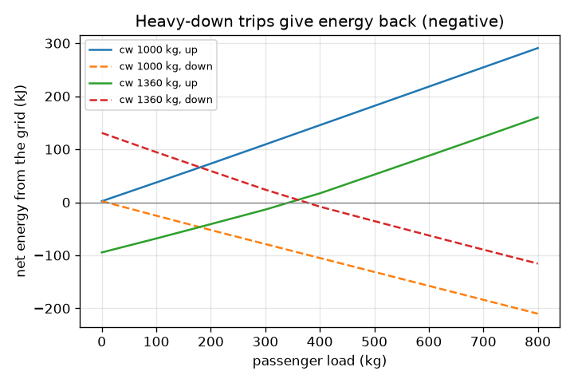
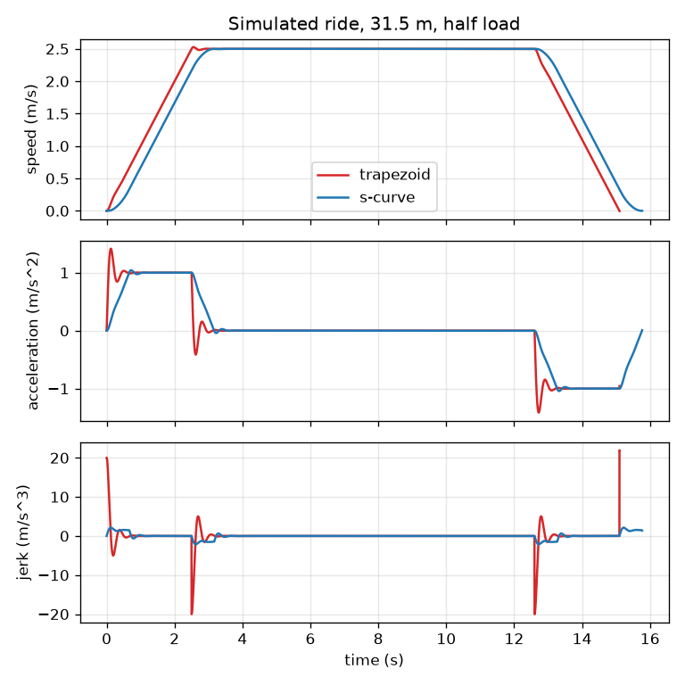

# Session 3: Simulating the whole lift: torque limit, comfort and energy

*Level 3 (simulation and validation) · about 90 minutes · openelevator*

> This is a simplified educational model. It is not a validated design tool and must not be used for real structures, electrical installations, vehicles, industrial processes or medical decisions.

**Prerequisites**

- Session 1: apparent weight and speed-time graphs.
- Session 2: S-curve profiles, counterweight and motor power.

**Learning objectives.** After this session you can:

- Simulate a cable-counterweight lift step by step with a motor force limit.
- Measure comfort by the peak acceleration and the peak jerk the passengers actually feel.
- Validate the simulation against the exact travel-time formula and an energy balance, including regeneration.
- Study how load and counterweight balance change energy and comfort, and choose a motor for a building.

## A. Real-world problem
Session 2 gave a clean plan. A real lift does not follow its plan exactly: its motor force takes a moment to build up, it has a limit, and a full car going up needs far more force than an empty one. If the motor is too small the ride falls behind its plan and the passengers feel it. How can we test this before building anything, and how do we know the simulation can be trusted? And what happens to the energy when a heavy car goes down?

## B. Concept and theory
The car, passengers and counterweight move together, so Newton's second law for the whole system is M a = F - (m_car + m_load - m_cw) g, which gives F = (m_car + m_load - m_cw) g + M a, with M = m_car + m_load + m_cw. The motor force F cannot exceed a limit F_max (its torque limit divided by the sheave radius), and it builds up with a time constant tau: dF/dt = (F_cmd - F) / tau. A controller asks for the force that would follow the plan, a_cmd = a_plan + kv (v_plan - v) + kp (x_plan - x). We step the equations forward in time with dt = 1 ms. The simulated acceleration is a = (F - unbalance) / M and the jerk is its time derivative. Comfort is judged by the peak |a| and peak |jerk| actually produced; we score it as the larger of peak a / 1.2 and peak jerk / 2.5 (assumed limits, a score of at most 1 is comfortable). We validate in two ways. First, with no saturation the simulated ride time must match the exact formula T = d / v + v / a + a / j. Second, since the speed starts and ends at zero, the net mechanical work of the motor must equal the change of potential energy of the unbalanced mass, integral of F v dt = (m_car + m_load - m_cw) g d. When this work is negative (heavy car going down, or light car going up) the motor is driven and can feed energy back, at efficiency eta.

| Symbol | Meaning | Unit |
|---|---|---|
| F | motor force on the rope (up positive) | N |
| F_max | motor force limit (torque limit / sheave radius) | N |
| M | total moving mass m_car + m_load + m_cw | kg |
| tau | time constant of the motor force | s |
| kp, kv | controller gains (position and speed) | 1/s^2 and 1/s |
| dt | time step | s |
| peak a, peak jerk | largest acceleration and jerk felt | m/s^2 and m/s^3 |
| E | energy drawn from or fed back to the grid | J |
| eta | efficiency of motor and drive | no unit |

**Assumptions**

- Simplified model: the rope is rigid, the sheave and rotor have no inertia, and there is no friction.
- tau = 0.05 s, kp = 100 1/s^2, kv = 20 1/s, eta = 0.85 and the comfort limits are assumed values.
- The simulation is for learning. It is NOT a validated lift design tool; real lifts follow safety standards and are designed and certified by qualified engineers.
- Regeneration works at the same efficiency as motoring; real drives differ.
- The holding brake is represented by starting with the force that carries the unbalanced weight.

$$ F=(m_{\text{car}}+m_{\text{load}}-m_{\text{cw}})\,g+M\,a,\qquad M=m_{\text{car}}+m_{\text{load}}+m_{\text{cw}} $$

$$ \tau\,\dot F=F_{\text{cmd}}-F,\qquad F_{\text{cmd}}=\mathrm{clip}\big(\text{unbalance}+M\,a_{\text{cmd}},\,-F_{\max},\,F_{\max}\big) $$

$$ a_{\text{cmd}}=a_{\text{plan}}+k_v\,(v_{\text{plan}}-v)+k_p\,(x_{\text{plan}}-x) $$

$$ \int F\,v\,dt=(m_{\text{car}}+m_{\text{load}}-m_{\text{cw}})\,g\,d\qquad(\text{speed is zero at both ends}) $$

$$ P_{\text{el}}=\frac{F v}{\eta}\ (Fv\ge 0),\qquad P_{\text{el}}=\eta\,F v\ (Fv<0,\ \text{fed back}) $$

## C. Visual explanation
The first figure stacks speed, acceleration and jerk of a simulated 31.5 m half-load ride for the trapezoid (red) and the S-curve (blue). The trapezoid is 0.67 s quicker, but its acceleration overshoots to 1.41 m/s^2 and its jerk spikes to about 22 m/s^3, almost nine times the comfort limit of 2.5, while the S-curve peaks at 1.04 m/s^2 and 2.1 m/s^3. The second figure plots the net energy taken from the grid against passenger load for two counterweights, up and down: the curves for a heavy car going down are negative, meaning energy is fed back, and a lighter counterweight shifts every curve upward.

*Net energy from the grid against load: heavy cars going down feed energy back.*

*Simulated 31.5 m ride: speed, acceleration and jerk for the trapezoid (red) and the S-curve (blue).*

## D. Interactive simulation
Run the lesson (`python start.py 3`), then open the live app: [Session 3: simulate the lift and compare the profiles](https://krunalpanchal1995.github.io/openelevator/session-03/) (or `app.html` in this folder). Open the comfort meter and compare the two profiles, then change the motor force limit until the S-curve saturates. Try a heavy car going down (direction -1) and watch the net energy turn negative.

**Challenge.** Make the lift return energy to the grid on the whole ride (net energy negative).

## E. Worked example and experiment
**Problem.** A half-loaded car (400 kg of passengers) rides 31.5 m up with maximum speed 2.5 m/s, acceleration 1.0 m/s^2 and jerk limit 1.5 m/s^3. (1) What travel time does the formula give and what does the simulation give? (2) What mechanical work should the motor do, and does the simulation agree? (3) A full car (800 kg) goes down the same 31.5 m: how much energy is fed back?

1. Formula: T = d / v + v / a + a / j = 31.5 / 2.5 + 2.5 / 1.0 + 1.0 / 1.5 = 12.6 + 2.5 + 0.667 = 15.77 s. The simulation gives 15.77 s (15.770 s), a difference of about 3 ms.
2. Unbalanced mass = 1000 + 400 - 1360 = 40 kg. Work = 40 * 9.81 * 31.5 = 12 360 J, about 12.4 kJ. The simulated integral of F v dt is 12.35 kJ, within 1 percent.
3. Full car going down: unbalanced mass = 1000 + 800 - 1360 = 440 kg, so the work is -440 * 9.81 * 31.5 = -136.0 kJ. The motor is driven during the whole ride, so the grid supplies nothing.
4. Energy fed back = eta * 136.0 kJ = 0.85 * 136.0 = 115.6 kJ, which is what the simulation reports (115.6 kJ).
5. Comfort check: the simulated peak acceleration is 1.04 m/s^2 and the peak jerk is 2.13 m/s^3, both within the limits (score 0.87).

**Answer.** T = 15.77 s (formula and simulation agree within 3 ms), motor work 12.4 kJ going up, and a full car going down feeds back 115.6 kJ.

**Experiment.** Time a real lift with a stopwatch over a known number of floors (count the floors, measure one floor height with a tape or take about 3 to 3.5 m) and compare with the formula; use a phone accelerometer to read the peak acceleration. Your measured time will be longer than the formula for short rides because real controllers use gentler profiles and add door and levelling time. Model versus reality: the model has a rigid rope, no friction and no rope sway, and its comfort limits are assumed. Real lifts may also not regenerate at all, depending on the drive.

## Real-world application and mini-project: Choose the motor and the profile for a 10-storey building
A building has 10 storeys with 3.5 m between floors, so the longest ride is 9 floors = 31.5 m. The lift has an empty car of 1000 kg, a rated load of 800 kg and a counterweight of 1360 kg. Passengers must feel a peak acceleration of at most 1.2 m/s^2 and a peak jerk of at most 2.5 m/s^3 (assumed comfort limits), the ride must follow its plan (travel time within 0.02 s of the formula) and the motor force limit must never be reached. Candidate motor force limits are 6000, 7000, 7500, 8000 and 9000 N. Use `plan`, `simulate` and `comfort_score` from Session 3 to test the worst cases, a full car going up and an empty car going down, with the trapezoid and with the S-curve (maximum speed 2.5 m/s, acceleration 1.0 m/s^2, jerk 1.5 m/s^3).

**Deliverable:** A script that prints, for each candidate force limit and each profile, the travel time, peak acceleration, peak jerk, comfort score and whether the motor saturated; names the smallest motor and the profile that pass; reports the peak electrical power of the full-car ride in kW; and saves a figure comparing the two profiles.

**Success looks like:** The trapezoid fails the comfort limit for every candidate motor (its peak jerk is about 22 m/s^3 even for the largest), the S-curve passes with the 7500 N motor and larger ones, the smallest passing force limit is reported as 7500 N, and the peak electrical power is reported as about 19 kW.

## F. Assessment and design challenge
**Question type A: Conceptual.** The trapezoid plan never asks for more than 1.0 m/s^2, yet the simulated trapezoid ride peaks at 1.41 m/s^2 with a very large jerk. Why?

Hint

Think about what a sudden step in the plan does to a motor force that takes time to build up and a controller that corrects errors.

Step-by-step solution

The plan jumps in acceleration, but the motor force can only build up with the time constant tau = 0.05 s, so the lift lags behind the plan at first. The feedback controller then asks for extra force to catch up, and the force overshoots, so the acceleration peaks above the plan. The sudden change also forces a large rate of change of force, which is the jerk (about a / tau). The S-curve asks for gradual changes that the motor can follow, so it hardly overshoots.

**Question type B: Numerical.** A car carrying 200 kg goes up 31.5 m. Use the energy balance to find the mechanical work, and say whether the grid draws or receives energy over the whole ride.

Hint

Unbalanced mass = 1000 + 200 - 1360. Work = unbalanced mass * g * d.

Step-by-step solution

Unbalanced mass = 1000 + 200 - 1360 = -160 kg, so the work is -160 * 9.81 * 31.5 = -49.4 kJ: the counterweight is heavier and pulls the car up, so the motor is driven. Over the ride the motor still draws a little energy while accelerating and gives back more while braking: in the simulation the grid supplies 3.1 kJ and receives 44.2 kJ, a net of -41.2 kJ (energy fed back). Check: 0.85 * 49.4 = 42.0 kJ, close to 41.2 kJ, because the acceleration phases add small losses in both directions.

**Question type C: Graph and simulation interpretation.** On the energy-against-load figure, why does the 'up' curve for the 1360 kg counterweight cross zero at a load of 360 kg, and what does a lighter counterweight do?

Hint

When is the unbalanced mass zero?

Step-by-step solution

The net mechanical work is (1000 + load - cw) g d, zero when load = cw - 1000 = 360 kg (the car is perfectly balanced), apart from the small losses of accelerating. Below that load the car going up is lighter than the counterweight and energy is fed back, above it the motor draws energy. A lighter counterweight (1000 kg) moves the zero to a load of 0 kg, so every load costs more going up and gives back more going down.

**Question type D: Design and optimisation challenge.** Design: for the 10-storey building (31.5 m), the car has 1000 kg, the rated load is 800 kg, the counterweight is 1360 kg. Choose the smallest motor force limit from 6000, 7000, 7500, 8000 and 9000 N and the profile, so that the comfort score is below 1 and the motor never saturates. Give the peak electrical power and one trade-off.

Hint

Hand estimate: F needed is about the unbalanced weight plus M a at full load. Then use simulate() on a full car going up and an empty car going down.

Step-by-step solution

Hand estimate: full car, F = 440 * 9.81 + 3160 * 1.0 = 4316 + 3160 = 7476 N, so about 7.5 kN is needed; the simulation peak is 7608 N because the controller overshoots slightly. The 6000 N and 7000 N motors saturate, and the ride has peak accelerations above 3 m/s^2 (score above 19), while 7500 N follows the plan (score 0.87). The trapezoid has a score of 11.1 even with the 7500 N motor and 8.8 with 9000 N, so it never passes. Choose the S-curve with a 7500 N motor (a margin would suggest 8000 N). The peak electrical power of the full-car ride up is about 19.2 kW, so the drive should be rated above that. Trade-off: a bigger motor costs more and handles loads better, a smaller jerk limit gives a gentler ride but a longer travel time.

Score yourself with [RUBRIC.md](../../RUBRIC.md). Print the [activity sheet](activity_sheet.md) to work on paper.

## Common misconceptions
| Common misconception | What is actually true |
|---|---|
| If the plan asks for 1.0 m/s^2, the passengers feel at most 1.0 m/s^2. | A real motor and controller overshoot and lag. The ride can exceed the plan, so plan with a margin below the comfort limit. |
| A bigger motor always gives a more comfortable ride. | Once the motor does not saturate, comfort depends on the profile (jerk), not on the motor size. |
| A lift always uses energy. | A heavy car going down (or a light car going up) drives the motor, which can feed energy back to the grid. Net energy can be negative. |
| A simulation that runs without errors is correct. | It is trustworthy only after checks against known results: here the travel-time formula and the energy balance. |

## Glossary
- **saturation**: the motor is at its force limit and cannot give more
- **regeneration**: feeding energy back to the grid when the load drives the motor
- **time step**: the small interval dt by which a simulation advances in time
- **energy balance**: net work done equals the change in energy, used to check a simulation
- **torque**: turning force of the motor; force on the rope = torque / sheave radius

## Finish
1. Do the three coding tasks in [exercises.md](exercises.md).
2. Run `python start.py 3` again after your changes. It ends with the checkpoint; when it prints `PASS`, you are done. (Checkpoint only: `python start.py check 3`.)

Next: the [roadmap](../../promo/roadmap.md). Session 4 is yours to build.
